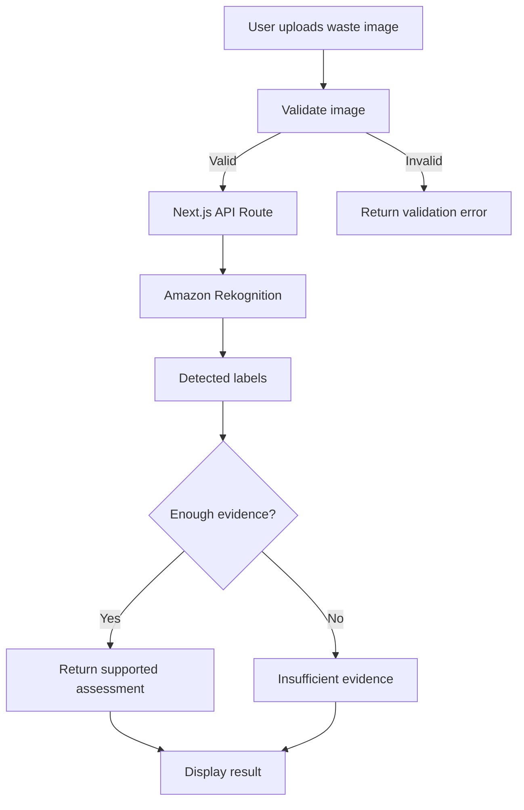

# ♻️ Segregation Score

**AI-Assisted Community Waste Auditing & Segregation Verification**

Segregation Score is a web-based waste-audit application designed to help housing societies, hostels, and communities assess waste segregation through image-based analysis. It combines computer vision with evidence-based assessment to help identify waste-related objects and highlight when additional verification is needed.

The goal is simple: make waste segregation easier to inspect, understand, and improve at the community level.

## 🌍 Problem Statement

Improper waste segregation makes recycling and waste processing more difficult. Communities need practical ways to inspect waste, identify potential segregation issues, and encourage responsible disposal practices.

Manual audits can be time-consuming and difficult to standardize. Segregation Score explores how AI-assisted image analysis can support this process while making uncertainty visible instead of treating every prediction as a confirmed result.

## 💡 Our Solution

Segregation Score provides an interface where users can upload a waste image, select the relevant waste stream, and receive an AI-assisted analysis.

The application is designed around four waste streams:

- **Wet Waste** — food scraps and other biodegradable waste.
- **Dry Waste** — recyclable materials such as paper, plastic, and metal.
- **Sanitary Waste** — sanitary products requiring appropriate disposal.
- **Special Waste** — waste requiring separate handling or specific disposal procedures.

The system separates object detection from waste-category assessment. When the available evidence is insufficient to determine the correct category, the application can return an inconclusive assessment rather than make an unsupported classification.

##  Key Features

- **Image Upload:** Upload supported waste images in JPG, JPEG, PNG, or WebP format.
- **AI-Powered Analysis:** Uses Amazon Rekognition to identify objects and visual labels in submitted images.
- **Four-Stream Waste Framework:** Organizes the workflow around wet, dry, sanitary, and special waste.
- **Evidence-Based Assessment:** Distinguishes detected labels from confirmed waste categories.
- **Uncertainty Handling:** Supports an insufficient-evidence outcome when the available labels do not justify a reliable assessment.
- **Input Validation:** Checks supported image formats and enforces a 5 MB upload limit.
- **API-Based Architecture:** Processes analysis requests through a Next.js API route.
- **Deployment-Ready Frontend:** Built with Next.js, TypeScript, and Tailwind CSS.

## ⚙️ Technology Stack

| Layer | Technologies |
|---|---|
| Frontend | Next.js, React, TypeScript |
| Styling | Tailwind CSS |
| Backend API | Next.js Route Handlers |
| Image Recognition | Amazon Rekognition |
| AWS SDK | AWS SDK for JavaScript v3 |
| Deployment | Vercel |
| Experimental Model | Ultralytics YOLO, trained on TACO data |

The experimental YOLO model is separate from the currently deployed Rekognition-based analysis path. It is not presented as a production-validated model.

## 🏗️ Application Workflow

1. **Upload:** The user selects a waste image and chooses a waste stream.
2. **Validate:** The application checks the image format and file size.
3. **Analyze:** The frontend sends the image to the `/api/analyze` endpoint.
4. **Detect:** Amazon Rekognition returns general-purpose object and scene labels.
5. **Assess:** The application evaluates whether the available evidence supports a waste-category assessment.
6. **Respond:** The user receives the analysis result or an indication that further verification is required.



##  Getting Started

### Prerequisites

- Node.js and npm
- An AWS account with Amazon Rekognition access
- AWS credentials configured securely
- Git

### 1. Clone the repository

```bash
git clone <YOUR_GITHUB_REPOSITORY_URL>
cd segregation-score
```

### 2. Install dependencies

```bash
npm install
```

### 3. Configure environment variables

Create a `.env.local` file in the project root.

```env
AWS_REGION=ap-south-1
AWS_ACCESS_KEY_ID=your_aws_access_key_id
AWS_SECRET_ACCESS_KEY=your_aws_secret_access_key
```

Use credentials belonging to a dedicated IAM identity with only the permissions required by the application. Never commit `.env.local`, access keys, or secret keys to GitHub.

For deployment, configure the corresponding variables in your Vercel project's environment settings. Redeploy after changing production environment variables.

### 4. Start the development server

```bash
npm run dev
```

Open [http://localhost:3000](http://localhost:3000) in your browser.

### 5. Build for production

```bash
npm run build
```

To start the production build locally:

```bash
npm run start
```

## 🔐 Security & Responsible AI

Segregation Score is designed with the following principles:

- **Credential protection:** AWS secrets must remain in environment variables and must never be committed to source control.
- **Input validation:** Uploaded images are restricted by file type and size.
- **Evidence over assumptions:** General object labels should not automatically be treated as verified waste classifications.
- **Transparent uncertainty:** The application should indicate when a reliable assessment cannot be established.
- **Responsible interpretation:** AI-generated labels are decision-support signals, not a replacement for applicable waste-disposal rules or human verification.

For example, detecting a bottle does not necessarily establish whether it is made of glass or plastic. The application should not claim a material-specific result without sufficient supporting evidence.

## 🧪 Experimental Model Development

An experimental YOLO model was trained using the TACO (Trash Annotations in Context) dataset to explore waste-object detection.

The model remains experimental and has not demonstrated sufficient validation performance to justify replacing the deployed recognition workflow. Its predictions should not be interpreted as reliable production classifications.

The project therefore keeps the experimental model separate from the deployed analysis path until its performance can be properly evaluated.

## 🗺️ Roadmap

- [ ] Improve waste-material classification and category mapping.
- [ ] Evaluate detection performance using a manually verified test set.
- [ ] Expand support for common community waste types.
- [ ] Add structured audit history and reporting.
- [ ] Explore community-level segregation scorecards.
- [ ] Improve explainability and confidence-aware assessment.
- [ ] Validate the system across different lighting conditions, backgrounds, and waste mixtures.

## 🎯 Intended Impact

Segregation Score explores how accessible AI-assisted tools can support better waste-management practices in housing societies, hostels, and other communities.

By combining image-based analysis with transparent uncertainty handling, the project aims to make community waste audits more understandable and encourage more responsible segregation practices.

## 👥 Team

**Team Srijan**

Built as part of Environment Hacks, an environmental innovation hackathon.

## 🤝 Contributing

Contributions, bug reports, and suggestions are welcome.

1. Fork the repository.
2. Create a feature branch.
3. Commit your changes.
4. Open a pull request describing the improvement.

Please avoid committing credentials, private datasets, or large model checkpoints.

## 📄 License

MIT LICENSED

Copyright (c) 2026 Harsh Bhadoriya

Permission is hereby granted, free of charge, to any person obtaining a copy
of this software and associated documentation files (the "Software"), to deal
in the Software without restriction, including without limitation the rights
to use, copy, modify, merge, publish, distribute, sublicense, and/or sell
copies of the Software, and to permit persons to whom the Software is
furnished to do so, subject to the following conditions:

The above copyright notice and this permission notice shall be included in all
copies or substantial portions of the Software.

THE SOFTWARE IS PROVIDED "AS IS", WITHOUT WARRANTY OF ANY KIND, EXPRESS OR
IMPLIED, INCLUDING BUT NOT LIMITED TO THE WARRANTIES OF MERCHANTABILITY,
FITNESS FOR A PARTICULAR PURPOSE AND NONINFRINGEMENT. IN NO EVENT SHALL THE
AUTHORS OR COPYRIGHT HOLDERS BE LIABLE FOR ANY CLAIM, DAMAGES OR OTHER
LIABILITY, WHETHER IN AN ACTION OF CONTRACT, TORT OR OTHERWISE, ARISING FROM,
OUT OF OR IN CONNECTION WITH THE SOFTWARE OR THE USE OR OTHER DEALINGS IN THE
SOFTWARE.

---


**Segregation Score — Turning waste audits into actionable insights.**
